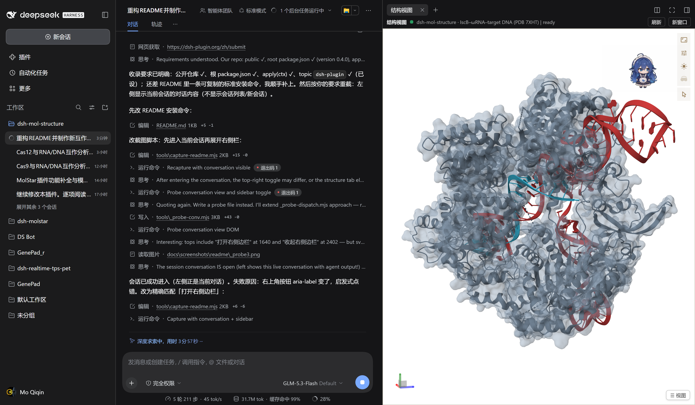
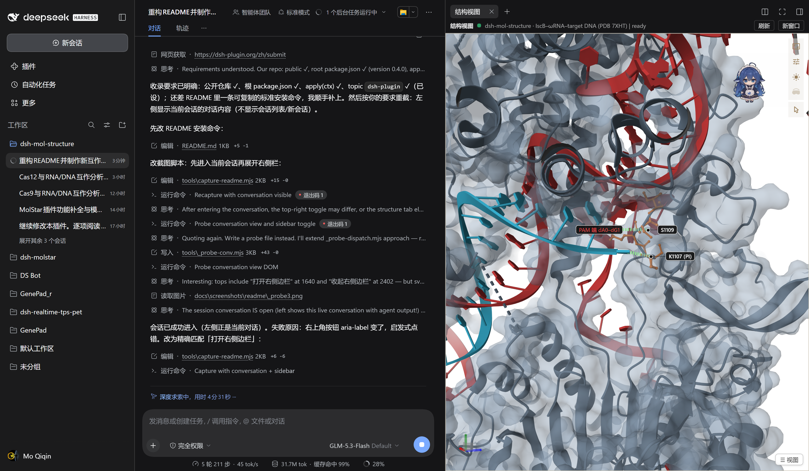
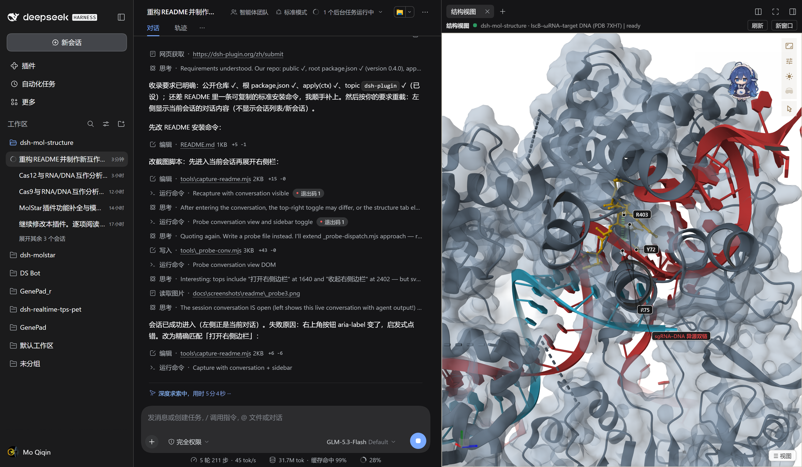

# dsh-mol-structure

**GitHub**: <https://github.com/Masterchiefm/dsh-mol-structure> · License: MIT

一个让 **DeepSeek Harness (dsh)** 能够进行结构生物学信息分析、展示的插件：在 dsh 右侧
边栏内嵌本地 [Mol\*](https://molstar.org) v5 结构查看器，让你在对话里直接加载、渲染、
标注和分析分子结构（PDB/mmCIF 等），AI 可以将结构生物学分析的图像直接展示给你。

## 1. 这个插件能干什么

- **右侧边栏 3D 视图** — 在 dsh 桌面端/Web 端的右侧边栏出现「结构视图」页签，
  内嵌完整的 Mol\* 查看器（简洁 agent 画布 / 完整 Mol\* 界面两种模式），切换页签
  场景常驻不丢失。
- **Agent 工具** — 22 个 `mol_*` 工具：加载结构（`mol_load`）、建场景/换表征
  （`mol_scene` / `mol_style`）、注册可回放视图（`mol_panel_define`）、测量与氢键
  标注（`mol_measure` / `mol_hbonds` / `mol_structconn`）、Cα 叠合（`mol_align`）、
  状态存取与导出（`mol_state` / `mol_export`）、截图（`mol_screenshot`）等。对话里
  说"加载 6w5c""看一眼 PAM 口袋"即可驱动。
- **结构分析** — 链组成清点、界面残基接触统计（加载后自动注册总览 + 界面特写
  视图）、半透明 surface + cartoon + 侧链 stick 的出版级外观、距离线与标签标注。
- **双向感知** — 用户在 3D 视图点击残基会回报给 agent（`mol_status` /
  `mol_select` 可读）；本机任意程序也能经 `POST /api/mol-structure/command`
  用同一套命令词汇驱动查看器。

> **给 agent 的提示（展示结构时必做）**：插件无法强制展开 dsh 的右侧栏（那是宿主
> UI 状态，插件没有 API 碰它），只能请求切换到「结构视图」页签。因此凡是涉及结构
> 展示/分析的请求，agent 应在 `mol_load` 等 3D 操作**之前**主动调用 `mol_panel`
> 打开右侧边栏的结构视图页签，让用户立即看到画面，而不是只汇报文字结果。

下图即插件在 dsh 里的实际样子：左侧是对话，右侧边栏是「结构视图」查看器
（SaCas9 半透明 surface + cartoon，sgRNA 红色 / 目标 DNA 青色 cartoon）：



## 2. 安装

### 方式 A · 让 dsh 里的 agent 安装（推荐）

在任一已打开的 dsh 会话里直接对 agent 说：

> 请安装插件 `https://github.com/Masterchiefm/dsh-mol-structure`

agent 会调用 `plugin_manager`（`install_bundle`，target = 仓库目录的**绝对路径**，
真实目录、不要符号链接）——自动完成 profile 依赖登记、`cordis.patch.yml` 挂载与
client 半身注册。装完重启应用（或新开会话），右侧边栏出现「结构视图」卡片。

### 方式 B · 桌面端手动安装

设置 → 插件 → **本地路径安装**，指向克隆出的目录；或者手动放置：

1. copy the package（含 `dist/`）to `%DSH_HOME%\profiles\desktop\node_modules\dsh-mol-structure\`
2. add `"dsh-mol-structure": "*"` to the profile `package.json` `dependencies`
3. append `"dsh-mol-structure"` to `dsh.profile.bundles`

Do **not** add an entry to the profile `cordis.patch.yml` — the bundle's own
`cordis.patch.yml` (one `insert` row, id `mol-structure`) applies automatically.

### 安装后自检

1. 右侧边栏出现「结构视图」卡片 → 对 agent 说「打开结构视图」（agent 会调
   `mol_panel` 切到该页签；右侧栏被收起时请在 UI 里展开）；
2. 对 agent 说「加载 4oo8」→ `mol_load` 返回链清单并自动注册总览/界面视图；
3. 在 3D 视图点击残基 → agent 用 `mol_status` 能读到该次点击。

> 纯 web profile（`dsh web`）源码安装（复制即可用）：
>
> ```bash
> dsh plugin --profile web add github:Masterchiefm/dsh-mol-structure
> ```

### 检查更新与插件内自升级（v0.5.0 起）

插件自带更新通道，默认**开启自动检测**（每 6 小时，可在 设置 → General →
「结构视图：自动检查更新」改为 每天/每周/关闭）。发现新版本时：

- 已打开的设置页会显示更新横幅，SSE 会向浏览器半身推送一次 `update` 提醒；
- 点「检查更新」立即查询；点「立即更新并重载」一键完成
  下载 → SHA-256 校验 → 备份 → 原子换文件 → 热重载（失败自动回滚）；
- 也可以直接调 HTTP 接口：
  `GET /api/mol-structure/update`（状态）、
  `POST /api/mol-structure/update/check`、
  `POST /api/mol-structure/update/apply`。

更新源固定为 GitHub 仓库 `Masterchiefm/dsh-mol-structure` 的
`feed/manifest.json`（raw.githubusercontent.com + jsDelivr 镜像，可变分支先钉到
完整 commit SHA）。清单里每个文件带 size + SHA-256，下载后逐一校验，任何一个字节
不符即拒绝安装并回滚。发新版流程：改代码 → bump `package.json` 与 `index.js`
的版本 → `npm run build`（改了 src/ 时）→ `npm run manifest` → 提交并推送
（含 `feed/manifest.json`）。


## 3. 示例案例：SaCas9–sgRNA–目标 DNA（PDB 4OO8）

对 agent 说「加载 4oo8 并看看它怎么识别 DNA」即可复现下面的过程。结构：
Staphylococcus aureus Cas9（SaCas9）– sgRNA – 目标 DNA 三元复合物
（PDB **[4OO8](https://www.rcsb.org/structure/4OO8)**，Nishimasu et al. 2015，
本地文件 `dist/structures/4oo8.cif`）。
链组成：**A** = SaCas9（aa 3–1366）· **B** = sgRNA（97 nt）· **C** = 目标 DNA TS（0–20，
PAM 端）· D/E/F 为晶体内第二个复合物副本。

统一外观规范：**蛋白 = 半透明 surface（alpha 0.45）+ 不透明 cartoon；DNA/RNA =
cartoon；互作特写处蛋白侧链用 ball-and-stick 突出**。agent 会把每个视角注册成
`mol_panel_define` 可回放面板（控制卡一键重现）。

### 总览

`mol_load` 后 agent 注册总览面板：蛋白半透明 surface 罩住 slate cartoon，
sgRNA（红）与目标 DNA（青）为 cartoon，嵌入中央通道的构象一目了然——
这就是第 1 节的截图。

### PAM 识别特写（蛋白–DNA 互作）

PI 域 S1106–I1110 环读 PAM 端碱基（dA0–dG1）：K1107/S1109 侧链 stick 贴住
PAM 端磷酸骨架，距离线标注接触。互作处同时显示 surface（半透明）、cartoon
（不透明）与侧链 stick：



### seed 异源双链特写（蛋白–RNA–DNA 互作）

sgRNA 5′ 段与目标 DNA 形成异源双链，REC lobe 正电槽残基 R75/Y72/R403 等
侧链 stick 夹住双链骨架，稳定 R 环构象：



三张图均为**真实 dsh 窗口截图**（左侧对话 + 右侧「结构视图」边栏），
由 `node tools/capture-readme.mjs` 无头生成，可随时重截。
