# dsh-mol-structure

**GitHub**: <https://github.com/Masterchiefm/dsh-mol-structure> · npm: `dsh-mol-structure`（待发布） · License: MIT

A **DeepSeek Harness (dsh) plugin** that embeds a local [Mol\*](https://molstar.org) v5
structural-biology viewer in the app's right sidebar, lets the **agent** load, render,
annotate and analyze molecular structures on request, and reports the **user's
selections/clicks** in the 3D view back to the conversation.

The same repo is also the offline reproduction of the structure figures
(Fig. 1–4) from:

> Kato, Okazaki, … Zhang & Nishimasu, *Nature Communications* 13, **6719** (2022)
> “Structure of the IscB–ωRNA ribonucleoprotein complex, the likely ancestor of CRISPR-Cas9”
> PDB **[7XHT](https://www.rcsb.org/structure/7XHT)** · Cas12i: **[6W5C](https://www.rcsb.org/structure/6W5C)** (Zhang 2020 NSMB)

…built with the `molstar` npm package + Vite. No remote resources are loaded at
runtime — structure files and the Mol\* UI stylesheet are bundled/served locally.

## What the plugin does

- **右侧边栏视图** — the browser half (`client.js`) registers a `结构视图` page type
  （内嵌模式下旧的论文面板按钮区默认收起，右上角 `☰ 面板` 一键唤出；bundle config
  `controlCard: 'show' | 'hide' | 'auto'` 可改默认行为；独立运行时保持展开）
  (guide card + keyed body) exactly like the built-in browser tab; the body is an
  iframe over the Host half's static viewer route. `keepMounted` keeps the Mol*
  scene alive across tab switches.
- **Agent 工具** — the Host half registers 22 `mol_*` tools on `ctx.tools`
  (see table below). Each forwards one command to the viewer page over an SSE
  bridge (`GET /api/mol-structure/events` → `command` events; results come back
  via `POST /api/mol-structure/result`).
- **两种查看模式** — 默认是 agent 驱动的简洁画布（控制卡 + 论文面板）；用户或 agent
  （`mol_mode` / 控制卡「完整 Mol*」按钮 / 设置默认值）随时切换到**完整 Mol\* 界面**：
  原生左侧控制树、序列视图、截图与动画工具栏——即 molstar.org/viewer 的全部交互能力。
- **用户操作感知** — the viewer reports clicks/selections in Mol* to
  `POST /api/mol-structure/selection`; `mol_status` surfaces the latest one, and
  `mol_select` with no arguments reads the live selection. Agent-driven
  selections are tagged `source: "agent"`, user clicks `source: "user"`.
- **自热重载** — `POST /api/mol-structure/reload` swaps the running plugin for
  the code on disk without restarting the app (ESM loadCache purge + re-import
  + re-register + rollback, mirroring the kernel's HMR sequence); bundle config
  `watch: true` adds a directory watcher for development. The viewer page
  reloads itself when the host generation or the built `dist/` fingerprint
  changes, and the browser half hot-swaps through the kernel's client-hmr.

## Install (desktop app)

**前置**：无需构建——`dist/` 已随仓库提交，克隆即可安装。只有在改 `src/` 重新出图/开发时才需要 Node ≥ 20。

### 方式 A · 让 dsh 里的 agent 安装（推荐）

任一已打开的 dsh 会话里，把仓库克隆到本地任意目录，然后直接对 agent 说：

> 请安装插件 `C:\path\to\dsh-mol-structure`

agent 会调用 `plugin_manager`（`install_bundle`，target = 仓库目录的**绝对路径**，真实目录、
不要符号链接）——它自动完成 profile `package.json` 依赖登记、`cordis.patch.yml` 挂载与
client 半身注册，`application: "applied"` 即生效。装完重启应用或新开会话，右侧边栏出现
**「结构视图」**卡片。

### 方式 B · 桌面端手动安装

设置 → 插件 → **本地路径安装**，指向克隆出的目录；或者手动放置（与任何第三方 bundle 相同）：

1. copy the package（含 `dist/`）to `%DSH_HOME%\profiles\desktop\node_modules\dsh-mol-structure\`
2. add `"dsh-mol-structure": "*"` to the profile `package.json` `dependencies`
3. append `"dsh-mol-structure"` to `dsh.profile.bundles`

Do **not** add an entry to the profile `cordis.patch.yml` — the bundle's own
`cordis.patch.yml` (one `insert` row, id `mol-structure`) applies automatically.

### 方式 C · 纯 web profile（`dsh web`）

```bash
git clone https://github.com/Masterchiefm/dsh-mol-structure.git
dsh plugin --profile web add C:\path\to\dsh-mol-structure
```

### 从 npm 安装（暂未发布）

包名 `dsh-mol-structure`（MIT，零运行时依赖，molstar 仅是 devDependency）。
当前作者的 npm token 无发布权限；具备权限后 `npm publish` 即可，届时
`install_bundle`/`dsh plugin add` 直接填 `dsh-mol-structure`。

### 安装后自检

1. 右侧边栏出现「结构视图」卡片 → 点击打开 iframe viewer；
2. 对 agent 说「加载 6w5c」→ `mol_load` 返回链清单并自动注册界面视图；
3. 在 3D 视图点击残基 → `mol_status` 能读到该次点击（`source: "user"`）。

### Config（bundle row `config`，均可选）

`watch: true`（dev 文件监视）、`screenshotDir`（默认 `%DSH_HOME%\mol-structure\shots`）、
`commandTimeoutMs`（默认 90000）、`controlCard: 'show'|'hide'`（强制面板卡显隐）、
`defaultMode: 'simple'|'full'`（打开时的查看器 UI）、`pixelScale`（渲染分辨率倍率 0.5–3，
默认 1.5——显存与截图清晰度随其平方变化）。后三项也暴露在设置 → General（持久化于
`%DSH_HOME%\mol-structure\settings.json`；bundle config 优先于存储值）。`mol_load` 接受
cif/bcif/pdb/ent/pdbqt/pqr/gro/xyz/mol/sdf/mol2 文件。

## Agent tools

| Tool | Purpose |
|---|---|
| `mol_panel` | open the Structure panel in the right sidebar (SSE → client half) |
| `mol_status` | viewer liveness + current figure/structure + latest user selection |
| `mol_figure` | apply a panel by id — the 18 built-in paper panels (calibrated camera/labels/H-bonds) or any registered custom panel |
| `mol_panel_define` | register a custom panel (scene groups + camera/focus + labels + H-bonds) as a clickable button in the viewer; agent 或外部程序都能注册 |
| `mol_load` | load a local mmCIF/PDB (absolute path or bundled `7xht.cif`/`6w5c.cif`), returns chain inventory |
| `mol_scene` | build a custom scene: colored component groups `{chain, ranges/residues/comp, repr, color}` |
| `mol_camera` | focus a residue / absolute orbit view / relative rotation |
| `mol_labels` | set HTML labels (pill/marker/text/circle) anchored by residue centroid, anchor key, or xyz |
| `mol_hbonds` | draw/clear residue–residue distance lines (H-bond annotation) |
| `mol_measure` | centroid distance between two residues (Å) |
| `mol_query` | `chains` inventory (molecule type, seq range) · `radius` contact map around a residue |
| `mol_select` | set/clear the Mol* selection; no args = report the current selection |
| `mol_screenshot` | capture the canvas (2× viewport) to a PNG file, returns the path |
| `mol_style` | add/replace a styled representation layer on the current structure (chain/ligand selection, repr, color, alpha) |
| `mol_focus` | Mol* focus manager: ball-and-stick close-up + non-covalent interaction circles |
| `mol_align` | least-squares Cα superposition of two chains → RMSD + transform (apply: true transforms the scene) |
| `mol_structconn` | wwPDB struct_conn: list/visualize deposited interactions (H-bond, salt bridge, disulfide, metal coordination) |
| `mol_canvas` | viewport render settings (background color) |
| `mol_state` | save/restore the full viewer state as a JSON snapshot file |
| `mol_export` | export the loaded structure as an mmCIF file |
| `mol_mode` | switch simple (agent-driven) ↔ full Mol* UI (control tree / sequence / toolbar, like molstar.org/viewer) |

HTTP surface (all behind the same trust fence the kernel applies to `/api`):
`/api/mol-structure/viewer/*` (static app), `/state`, `/status`, `/selection`,
`/result`, `/events` (SSE), `/load/<token>` (one-shot structure file download),
`/reload` (hot reload trigger).

### 给别的程序用的开放接口（POST /api/mol-structure/command）

本机任意程序（Python 脚本、另一个 agent、自动化工具）都能用同一套命令词汇驱动查看器，
无需经过 dsh 会话——信任围栏只放行本机回环、拒绝跨站请求：

```bash
# 切换视图（内置面板或已注册的自定义面板）
curl -s -X POST http://127.0.0.1:<port>/api/mol-structure/command \\
  -H 'content-type: application/json' \\
  -d '{"op":"figure","args":{"figure":"fig3c"}}'

# 注册一个自定义视图按钮（viewer 侧栏立即出现该按钮）
curl -s -X POST http://127.0.0.1:<port>/api/mol-structure/command \\
  -H 'content-type: application/json' \\
  -d '{"op":"panelDefine","args":{"id":"my-view","title":"我的视图",
        "groups":[{"chain":"A","ranges":[[87,122]],"color":"#2FCC3B"}],
        "focus":{"chain":"A","seq":100},"apply":true}}'
```

- viewer ops（转发给查看器执行）：`figure / figures / scene / camera / labels / hbonds /
  measure / select / query / screenshot / load / style / focus / align / structconn /
  canvas / toast / stateSave / stateLoad / export / mode / ui / interfaces`
  （load 支持 `path` 本地路径）
- host ops（宿主直接处理）：`panelDefine / panelRemove`（注册表经 SSE `panels` 事件同步到查看器按钮区）
- 返回 `{ok:true, result}`；未知 op 返回 400 并列出可用词汇。`GET /state` 与 SSE `hello`
  均携带 `customPanels` 清单。自定义面板定义保存在宿主内存（热重载/重启后需重新注册）。

## Case study: SpCas9–sgRNA–DNA 互作分析（4UN3）

结构：SpCas9–sgRNA–目标 DNA 三元复合物，PDB **[4UN3](https://www.rcsb.org/structure/4UN3)**
（Anders et al. 2014），本地文件 `public/structures/4un3.cif`。
链组成：**B** = SpCas9（aa 4–1364）· **A** = sgRNA（81 nt）· **C** = TS 目标链 · **D** = NTS 非目标链（含 5'-TGG PAM）。

六个关键视图已注册为可复用的自定义面板（`tools/capture-cas9.mjs` 中含完整定义，
`node tools/capture-cas9.mjs` 可一键无头重截全部成图）：

| 面板 | 内容 |
|---|---|
| `cas9-ov` | 域色总览：RuvC(蓝)/REC(灰)/BH(绿)/WED(黄)/HNH(粉)/PI(金) + sgRNA(红)/TS(玫红)/NTS(天蓝) + 催化残基 ball-and-stick |
| `cas9-surf` | 蛋白半透明 surface（alpha 0.45）+ 内部 cartoon + 核酸 cartoon |
| `cas9-pam` | PI 域 PAM 识别特写：R1333/R1335 读 PAM 碱基，K1107/E1108/S1136/K1118 夹磷酸骨架 |
| `cas9-duplex` | sgRNA–TS 异源双链（seed 区）与 REC 通道残基 R69–74/R403/Y450/F1105 碱基堆积 |
| `cas9-cat` | 双核酸酶中心：RuvC 四残基 D10/E762/D840/H983（切 NTS）· HNH D839/H840/N854/N863（切 TS）· Mg²⁺ |
| `cas9-mut` | 点突变候选残基一览（见下表） |

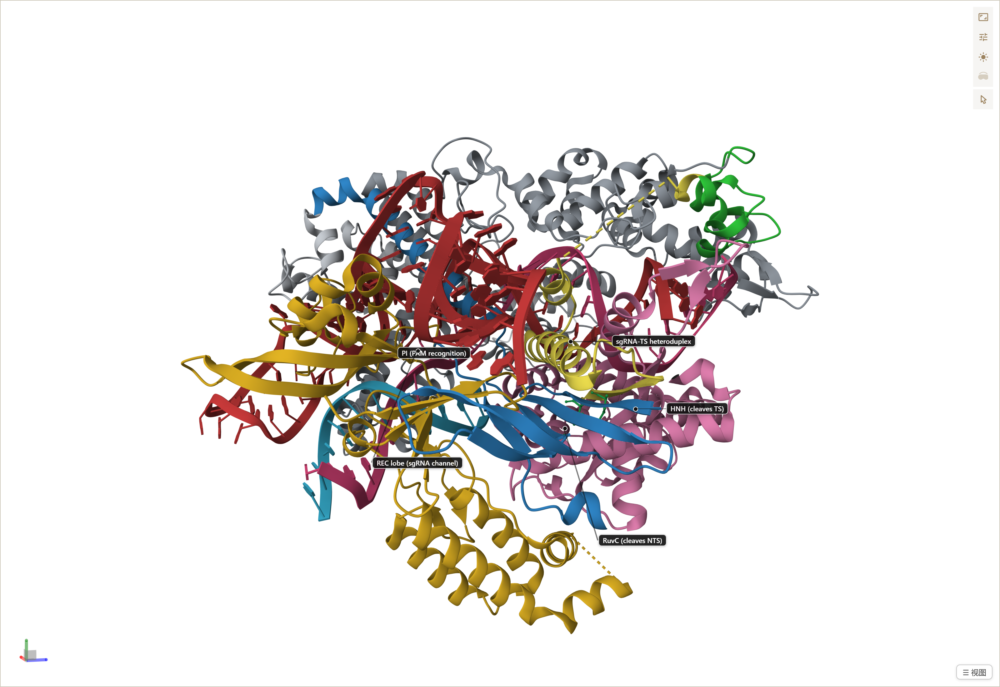

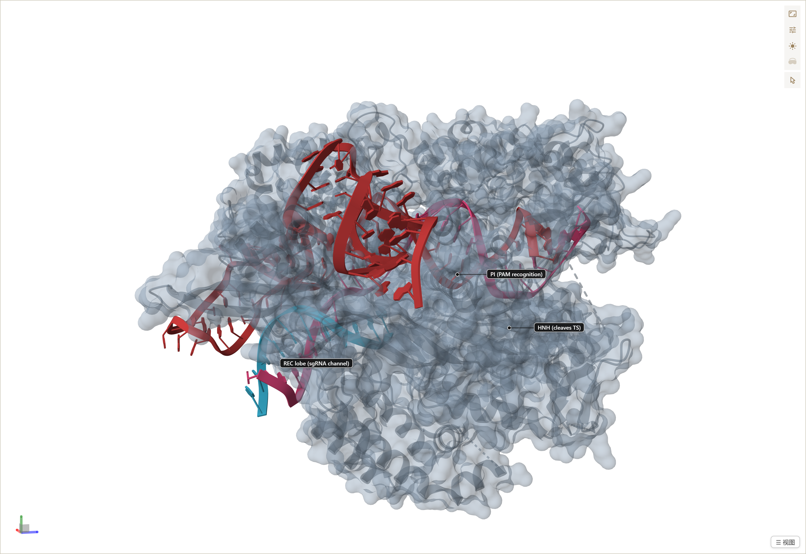

### 互作机制（本结构 + 沉积 struct_conn 佐证）

1. **PAM 识别（PI 域）**：PAM 双链（NTS 5'-TGG, +1..+3）插入 PI 域沟槽；R1333/R1335
   直接读 PAM 碱基（struct_conn hydrog88–106 覆盖 C1–G12 碱基对），Y1356/Q1350/S1351
   铺在沟槽面。PAM 决定链方向与 R 环起始。
2. **R-loop 与异源双链**：sgRNA(1–20) 与 TS(9–28) 形成 20 bp 异源双链，位于 REC lobe
   与 WED 构成的中央通道。R69/R70/R71/R74（正电簇）+ R403 沿磷酸骨架排布，
   Y450 是通道瓶颈、挤压非配对碱基向外翻转（seed 识别的结构基础）。
   F1105/H1349/Y1356 与 sgRNA 碱基堆积，稳定双链。
3. **双核酸酶激活**：异源双链形成后 HNH 构象切换到 TS 切割位（D839/H840 催化对，
   N854/N863 辅助），RuvC 四残基（D10/E762/D840/H983 + Mg²⁺，metalc17/18）切 NTS。
   Q926/N497 等中性极性残基贴住 TS 骨架。

### 离 RNA/DNA 最近的残基（重原子 ≤4.5 Å 接触数，`tools/cas9_contacts.py` 全表见 `docs/cas9/`）

| 排名 | 残基 | 接触数 | 最近距离 | 接触对象 |
|---|---|---|---|---|
| 1 | F1105 | 61 | 3.18 Å | sgRNA（碱基堆积） |
| 2 | Y72 | 50 | 3.36 Å | sgRNA（+TS 边缘） |
| 3 | Y450 | 49 | 2.60 Å | sgRNA + TS |
| 4 | R403 | 47 | 2.34 Å | sgRNA 骨架 |
| 5 | R69 | 43 | 2.88 Å | sgRNA 骨架 |
| 6 | F105 | 40 | 2.56 Å | sgRNA |
| 7 | R74 | 40 | 2.63 Å | sgRNA 骨架 |
| 8 | H328 | 40 | 3.05 Å | sgRNA |
| 9 | Y1356 | 40 | 3.35 Å | sgRNA/PAM |
| 10 | E1108 | 35 | 2.73 Å | TS 骨架 |
| 11 | K1107 | 32 | 2.82 Å | TS 骨架 |
| 12 | R1335 | 30 | 2.59 Å | NTS（PAM 碱基） |
| 13 | S1136 | 30 | 3.09 Å | NTS 骨架 |
| 14 | R1333 | 28 | 2.72 Å | NTS（PAM 碱基） |
| 15 | N497 | 25 | 2.68 Å | TS 骨架 |

### 点突变建议（提高核酸结合力）

原则：**别动已优化的正电簇与堆积对**（R69–74、R403、F1105/Y450 已饱和，突变更可能降低
活性）；要找的是"贴着核酸但带中性/负电"的残基，把它们改成 Lys/Arg 增加盐桥，或用
Pi-date 延展 PAM 兼容性。

| 残基 | 现状（4UN3 实测） | 建议突变 | 理由 |
|---|---|---|---|
| **N497** | TS 骨架 25 接触、2.68 Å，酰胺不形成盐桥 | N497K | 原位新增正电，直接夹住 TS 骨架磷酸（异源双链中部，远离催化位点，风险低） |
| **Q926** | TS 骨架 24 接触、2.74 Å | Q926K / Q926R | HNH 贴 TS 面，同上；避开 HNH 催化环（D839/H840 距离 >15 Å） |
| **S1136** | NTS 骨架 30 接触、3.09 Å，仅 OH 弱氢键 | S1136R | PI 域 NTS 骨架钳位升级为盐桥，增强 DNA 双链锚定 |
| **K1118** | NTS 骨架 27 接触、3.43 Å（侧链远） | 保持；或 K1118R（精胍基双齿氢键） | 拉近现有弱接触 |
| **R1333/R1335** | PAM 严格 TGG 的主读码 | 谨慎：R1335A/T1337R 组合参考 SpG/SpRY 工程路线 | 放宽 PAM 兼容性（结合力换广度，需实验验证） |
| **E1108** | Glu 负电却贴 TS 骨架 2.73 Å（可能水介导） | E1108Q（保守）先测 | 若为静电排斥则去除负电；避免直接加正电扰乱局部水网络 |
| R69/R70/R71/R74、R403、F1105、Y450 | 已饱和优化 | **保持野生型** | 突变大概率破坏 seed 识别或碱基堆积 |

> ⚠️ 以上为结构推断，活性位点附近（D10/E762/D840/H983、D839/H840 ±5 Å）禁改；
> 任何建议均需细胞/体外实验验证。

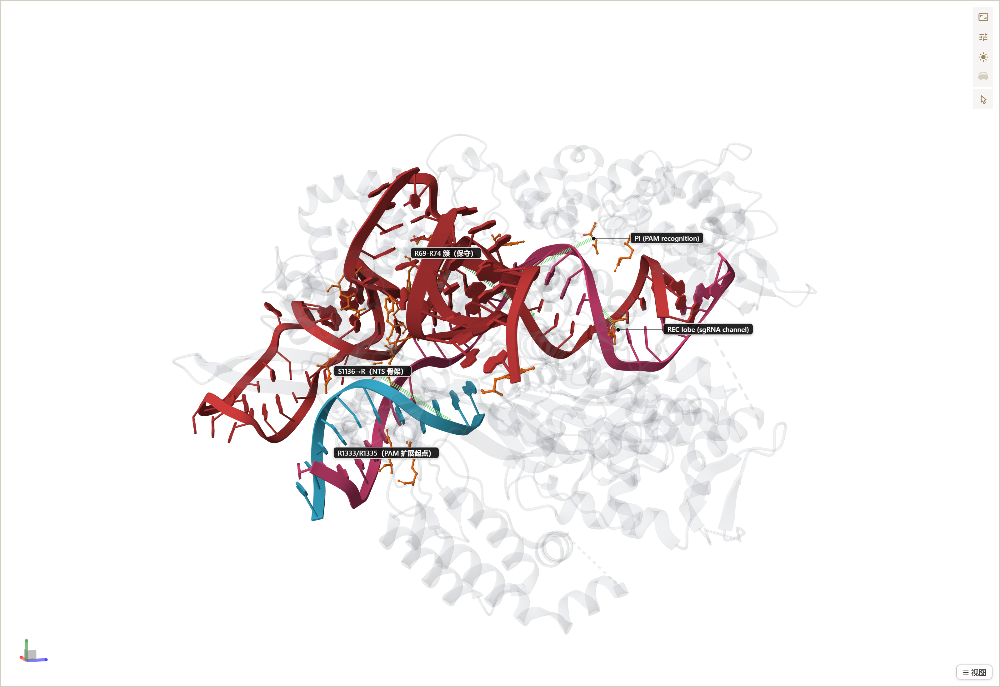

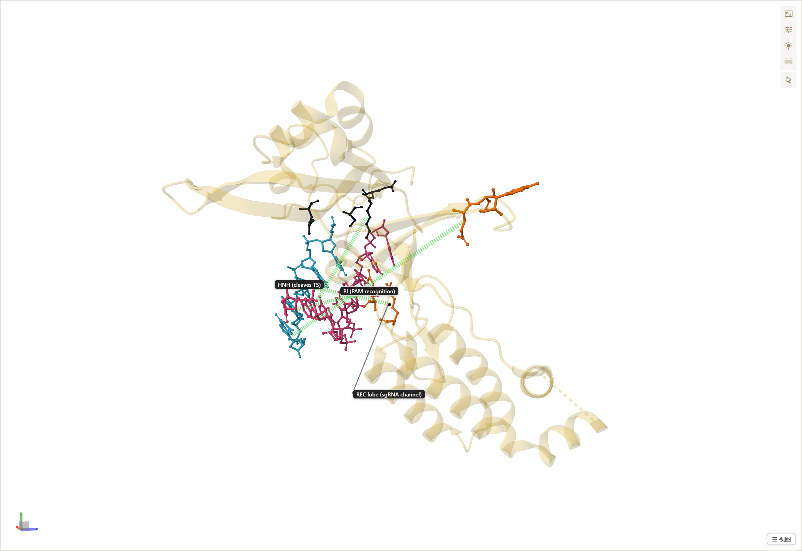

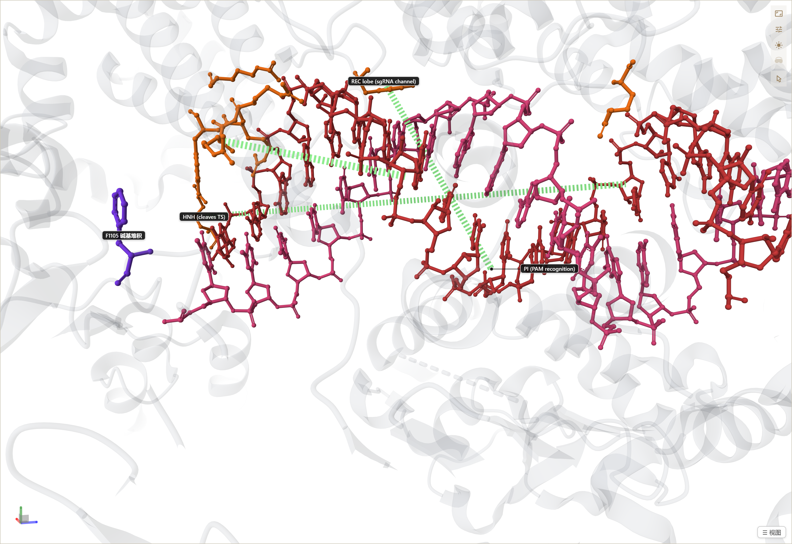

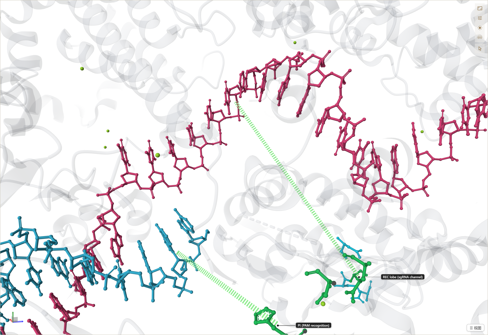

## Case study: Cas12i–crRNA–dsDNA 互作分析（6W5C）

结构：Cas12i E894A–crRNA–目标 DNA 三元复合物，PDB **[6W5C](https://www.rcsb.org/structure/6W5C)**
（Zhang et al., *Nat Struct Mol Biol* 27, 1069 (2020)），本地文件 `public/structures/6w5c.cif`。
链组成：**A** = Cas12i（aa 8–1093）· **B** = crRNA（−22…27）· **C** = TS 目标链（1–36）·
**D** = NTS（1–10，PAM 侧）· **E** = 底物 DNA（28–36，RuvC 位）。

外观规范（所有视图统一）：**DNA/RNA 用 cartoon，蛋白同时 cartoon + 半透明 surface（alpha 0.45）**；
关键残基与碱基用 ball-and-stick，接触用距离线。六个关键视图已注册为可回放自定义面板
（成图在 `docs/screenshots/cas12/`）：

| 面板 | 内容 |
|---|---|
| `cas12-ov` | 总览：蛋白半透明 surface + cartoon，crRNA 橙 / TS 品红 / NTS·底物 DNA 天蓝 |
| `cas12-pam` | PAM 识别口袋：S167/T168/H170/Y171（REC1）+ S482（WED）读 PAM duplex（红色 PAM 碱基） |
| `cas12-seed` | seed 区：crRNA(5–27)–TS(10–36) 异源双链 + REC1 正电荷槽 K313/K318/K321/Q431/R434/N415 |
| `cas12-catalytic` | RuvC/Nuc 催化中心：D647/E894A*/D1074 + L912/R952/N849，底物 DNA（NTS）与 TS 切点 |
| `cas12-crna5p` | crRNA 5′ 端识别与加工：WED RNase 位点 R22/R26/H527/H528/W511 + repeat 柄区 |
| `cas12-mut` | 11 个突变候选热点一览（红色 stick，见下表） |

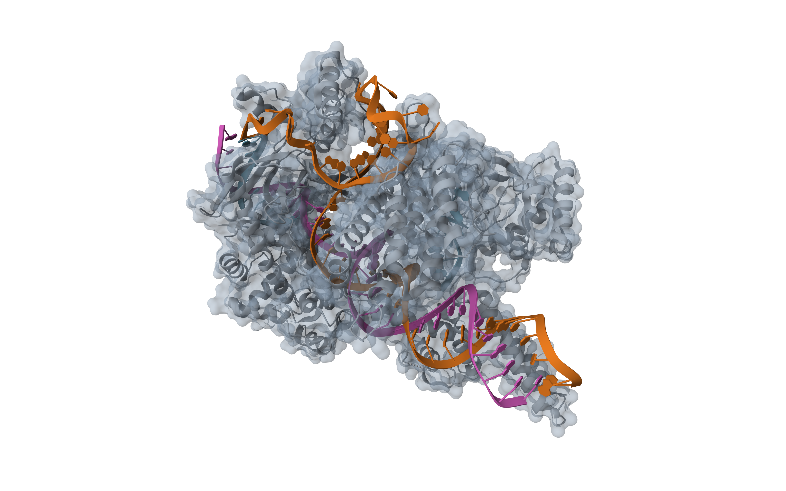

### 互作机制（本结构 + 沉积 struct_conn 佐证）

1. **PAM 识别（REC1/PI/WED）**：PAM duplex（TS 34–36 + NTS 8–10，红色）插入口袋；
   S167/T168/H170/Y171 主链氢键夹住 PAM 骨架磷酸（实测 Y171–NTS9 质心 5.9 Å），
   S482（WED）从背面锁住。Cas12i 属 T-rich PAM，蛋白与碱基边缘接触弱——识别主要靠骨架。
2. **R-loop / seed 异源双链**：crRNA guide 6–27 与 TS 10–31 形成 22 bp 异源双链
   （struct_conn hydrog80–103 覆盖全部碱基对），嵌在 REC1–WED 中央通道。
   K313/K318/K321（α 螺旋正电条）+ R434/Q431/N415 沿磷酸骨架排布，稳定 R 环。
3. **crRNA 5′ 加工与-repeat 识别（WED）**：5′ 柄区 U(−22…−17) 被 WED 沟槽夹持；
   R22/R26/R503/K589 抓磷酸骨架，H527/H528 是 crRNA 成熟加工的 RNase 位点（Fig. 2a）。
4. **RuvC 激活与切割**：异源双链形成使 NTS 被拉进 RuvC 峡谷；D647（RuvC-II）、
   E894*/D1074（RuvC-III，E894A 为结晶突变）构成催化三联体，L912/T944/W915 排布
   底物构象，R952 锚定切口 5′-磷酸，N849 辅助。TS 切点位于 dG23 附近（两步切割）。

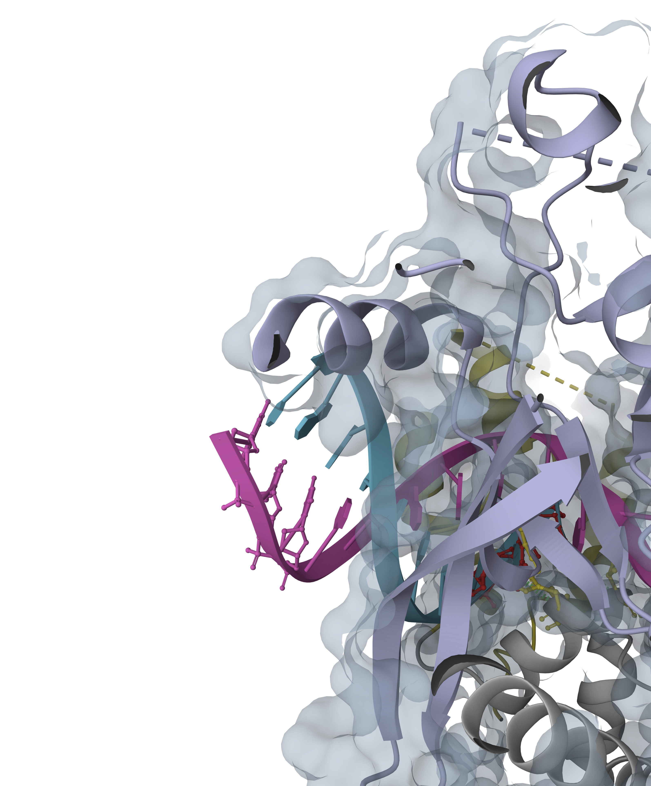

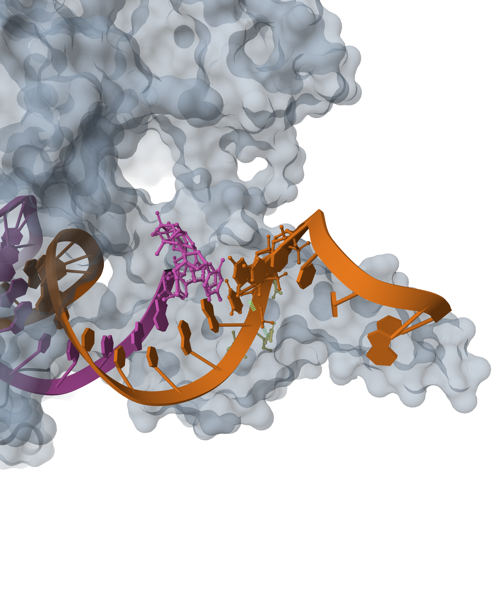

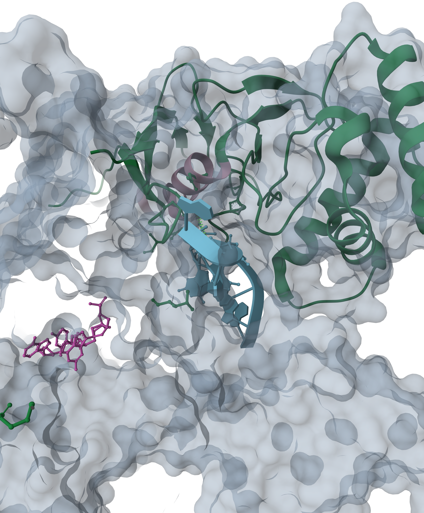

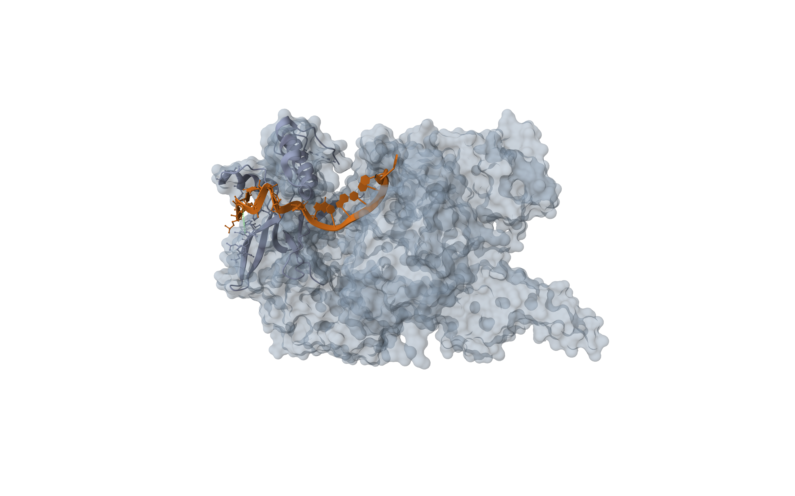

### 离 RNA/DNA 近、可改造的残基与点突变建议（提高结合力）

候选原则：贴着核酸骨架/碱基但侧链中性（Ser/Thr/Asn/Gln/Tyr），或侧链方向尚有余量
的 Lys/Arg —— 改成 Arg 可获得双齿氢键盐桥；**催化残基 ±5 Å 内禁改**
（D647/E894/D1074、H527/H528）。

| 位点 | 现状（6W5C 实测） | 建议突变 | 理由 |
|---|---|---|---|
| **S167 / T168**（REC1） | PAM 骨架仅 OH 弱氢键 | S167R / T168R | 原位新增正电夹 PAM 磷酸，增强 PAM-duplex 锚定（远离催化位点，风险低） |
| **Y171**（REC1） | 与 NTS9 质心 5.9 Å，芳香贴骨架 | Y171→R（或保守地 Y171F 先测） | 若去掉 OH 影响小，精胍基可双齿抓磷酸；提高 PAM 亲和 |
| **S482**（WED） | PAM 背面单点接触 | S482K / S482R | 与 REC1 侧形成对夹，加固 PAM duplex |
| **N415**（REC1） | seed 异源双链 5 Å 内，酰胺中性 | N415R / N415K | seed 骨架钳位升级为盐桥，加速 crRNA–TS 配对锁定 |
| **Q431**（REC1） | seed 骨架中性接触 | Q431R | 同上，位于 seed 中段，远离催化谷 |
| **K313 / K318 / K321**（REC1 α 螺旋） | 正电条已抓 seed 骨架 | 保持；或 K318R（精胍基更强） | 已优化方向，微调即可，勿加强制突变 |
| **R434** | seed 骨架（质心 10.7 Å，侧链可及） | 保持野生型 | 关键正电锚点，突变大概率降低 R 环稳定性 |
| **R503 / K589**（WED） | repeat 柄区磷酸骨架 | 保持；K589R 备选 | 5′ 柄识别相关，改动会影响 crRNA 加工效率 |
| **R22 / R26**（WED N 端） | crRNA 5′ 端磷酸 | 保持野生型 | 加工位点组件，动它影响成熟 crRNA 生成 |
| **R952**（RuvC） | 锚定切口 5′-磷酸 | 保持野生型 | 直接参与切割化学，临近活性位点禁改 |

> ⚠️ 以上为结构推断；任何改造需体外/cell 实验验证。E894A 是结晶突变，野生型为 E894。

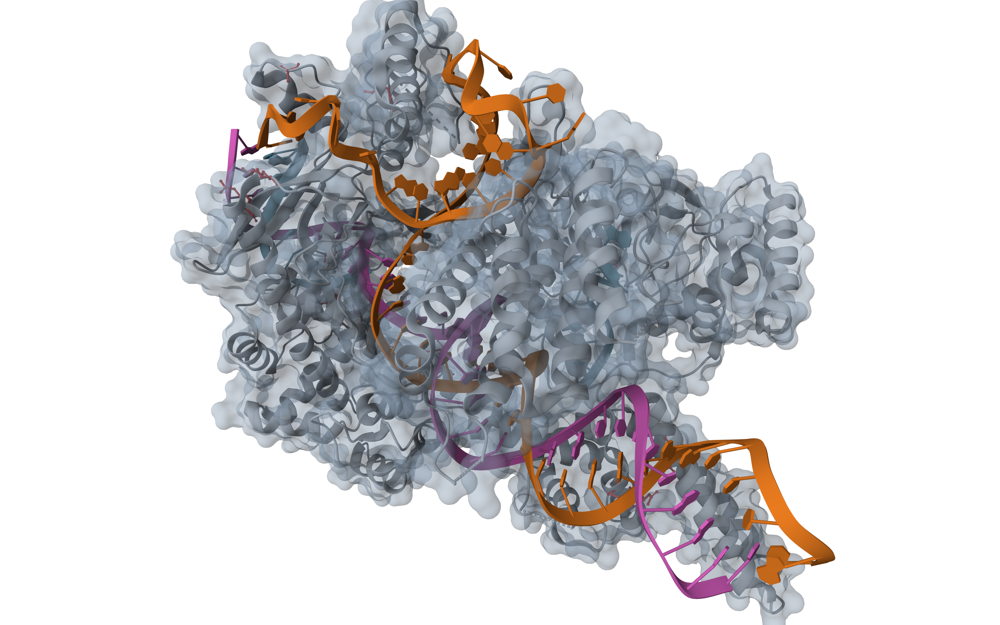

## 工具提示词 / 使用参考（给以后的 agent）

**总流程**：`mol_panel` → `mol_load`（读返回的 chain inventory！）→
`mol_load`/`mol_autoviews` 自动注册的界面视图 + `mol_panel_define` 注册任务专属视图 →
`mol_figure` 逐个应用 → `mol_camera` 取景 → `mol_screenshot` 出图。
**主动注册视图（policy，必须执行）**：分析任何结构时，把发现的关键视角（总览、界面特写、
催化/识别位点、突变候选）全部用 `mol_panel_define` 注册成可回放面板（同 id 幂等覆盖），
让用户能在控制卡一键回放——**禁止只做一次性 `mol_scene`**。参考案例：Cas9（4UN3）
与 Cas12i（6W5C）各 6 个面板，均带标签、H-bond 线与校准相机。
**特写配方（2026-11 起）**：面板 `view` 与 `mol_camera.view` 都接受
`target:[x,y,z]`（世界坐标取景中心，先用 `mol_camera focus` 探到坐标，再写进面板）；
`mol_camera.focus {chain,seq,radius}` 的 radius 是**半径倍率**（zoom=1/radius：
0.3≈3.3× 特写、1.6 默认）。只传 yaw/pitch/zoom 会回到全结构中心——特写必须带 target。
标签锚点残基必须真实存在（auth 编号有空档时 `mol_figure` 会报
`residue A/550 not found`——先用 `mol_select` 探查再写面板）。

| 工具 | 何时用 | 迷你示例 |
|---|---|---|
| `mol_panel` | 会话开始要看结构时最先调 | `{}` |
| `mol_load` | 加载结构文件；palette 顺序=返回 inventory 顺序；自动注册总览+界面特写 | `{"path":"C:/x/4un3.cif","closeup":0.3}` |
| `mol_autoviews` | 给已加载结构换界面视图配色/密度 | `{"palette":["#CF3A3A","#5158D8"],"apply":"auto-iface-AB"}` |
| `mol_query` | 先 `chains` 拿链表；`radius` 找结合位点邻居 | `{"mode":"radius","chain":"B","seq":983,"radius":6}` |
| `mol_select` | 探查残基是否存在（面板 ranges 会静默丢弃缺失残基）；无参=读用户点选 | `{"chain":"B","seqs":[10,762,840,983]}` |
| `mol_measure` | 先量距离再画线 | `{"a":{"chain":"B","seq":450},"b":{"chain":"A","seq":10}}` |
| `mol_hbonds` | 接触标注（整表替换语义） | `{"pairs":[{"a":{"chain":"B","seq":1335},"b":{"chain":"D","seq":11}}]}` |
| `mol_labels` | HTML 标签（截图 PNG 不含标签！） | `{"labels":[{"text":"R1335","chain":"B","seq":1335}]}` |
| `mol_scene` | 一次性场景（要复用请用 mol_panel_define） | 见下方「半透明 surface」配方 |
| `mol_panel_define` | **注册可回放视图**；同 id 幂等覆盖 | 见下方示例 |
| `mol_figure` | 应用内置/自定义面板；构建后等几秒再截图 | `{"figure":"cas9-ov"}` |
| `mol_camera` | 面板构建后 Mol* 会自动构图覆盖，特写要再设一次；特写带 `target`（focus 先探坐标） | `{"view":{"yaw":255,"pitch":15,"zoom":2.6,"target":[83.0,26.5,81.5]}}` 或 `{"focus":{"chain":"D","seq":2,"radius":0.3}}` |
| `mol_style` | 快速叠加一层（同 tag 替换）；alpha 透明度 | `{"chain":"B","repr":"molecular-surface","alpha":0.45,"tag":"surf"}` |
| `mol_focus` | 看单个残基接触圈 | `{"chain":"B","seq":983}` |
| `mol_align` | 两链 Cα 叠合出 RMSD | `{"a":{"chain":"A"},"b":{"chain":"C"}}` |
| `mol_structconn` | mmCIF 沉积相互作用清单（partners 含 chain/authSeq/atom） | `{"action":"list"}` |
| `mol_screenshot` | 画布 PNG（页签隐藏也能截）；带标签用整页截图或 `tools/capture-cas9.mjs` | `{}` |
| `mol_canvas` | 文献图用白底 | `{"backgroundColor":"white"}` |
| `mol_state` | 保存/恢复整个查看器工作区 | `{"action":"save","name":"cas9"}` |
| `mol_export` | 导出 mmCIF | `{"name":"out.cif"}` |
| `mol_mode` | 简洁/完整 Mol* UI 切换 | `{"full":true}` |

**半透明 surface 配方**（蛋白 cartoon+surface、核酸 cartoon）：

```json
{"op":"scene","args":{"groups":[
  {"chain":"B","kind":"ranges","ranges":[[1,1364]],"repr":"molecular-surface","color":"#8FA3B8","alpha":0.45},
  {"chain":"B","kind":"ranges","ranges":[[1,1364]],"repr":"cartoon","color":"#5B6B7B","alpha":0.5},
  {"chain":"A","kind":"ranges","ranges":[[1,81]],"repr":"cartoon","color":"#CF3A3A"},
  {"chain":"C","kind":"ranges","ranges":[[1,28]],"repr":"cartoon","color":"#E0457B"},
  {"chain":"D","kind":"ranges","ranges":[[2,12]],"repr":"cartoon","color":"#38B6D8"}]}}
```

**注册自定义视图配方**（可回放按钮，推荐所有分析都这么做）：

```bash
curl -s -X POST http://127.0.0.1:<port>/api/mol-structure/command \
  -H 'content-type: application/json' \
  -d '{"op":"panelDefine","args":{"id":"pam-pocket","title":"PAM 口袋",
        "groups":[{"chain":"D","kind":"ranges","ranges":[[10,12]],"repr":"ball-and-stick","color":"#DC2626"},
                  {"chain":"B","kind":"residues","residues":[1333,1335],"repr":"ball-and-stick","color":"#F97316"}],
        "hbonds":[{"a":{"chain":"B","seq":1335},"b":{"chain":"D","seq":11}}],
        "labels":[{"text":"R1335","chain":"B","seq":1335,"kind":"pill"}],
        "view":{"yaw":255,"pitch":10,"zoom":2.5,"target":[83.0,26.5,81.5]},"apply":true}}'
```

**特写面板完整参考小案例**（摘自 Cas12i `cas12-pam`，6W5C 实测可回放——以后的 agent
注册界面特写时照这个形状写）：

```jsonc
// 1) 先探焦点坐标与残基存在性
//    mol_select {"chain":"A","seqs":[167,168,170,171,482]}   → 残基在不在
//    mol_camera {"focus":{"chain":"D","seq":2,"radius":0.3}} → 读返回 camera.target
// 2) 注册（surface 半透明打底，特写区换 domain 色 cartoon + 关键残基 stick + H-bond 线）
{"op":"panelDefine","args":{"id":"cas12-pam","title":"PAM 识别口袋（REC1/PI/WED）",
  "groups":[
    {"chain":"A","kind":"ranges","ranges":[[1,1093]],"repr":"molecular-surface","color":"#8FA3B8","alpha":0.45},
    {"chain":"A","kind":"ranges","ranges":[[181,278]],"repr":"cartoon","color":"#F0E24C"},
    {"chain":"A","kind":"ranges","ranges":[[23,181]],"repr":"cartoon","color":"#BFBFBF"},
    {"chain":"C","kind":"ranges","ranges":[[1,36]],"repr":"cartoon","color":"#D95FC0"},
    {"chain":"D","kind":"ranges","ranges":[[1,10]],"repr":"cartoon","color":"#7EC8E3"},
    {"chain":"D","kind":"residues","residues":[8,9,10],"repr":"ball-and-stick","color":"#E23B3B"},
    {"chain":"A","kind":"residues","residues":[167,168,170,171,482],"repr":"ball-and-stick","color":"#F0E24C"}],
  "hbonds":[{"a":{"chain":"A","seq":171},"b":{"chain":"D","seq":9}}],
  "labels":[{"text":"S167","chain":"A","seq":167,"kind":"pill"},
            {"text":"PAM (NTS 8-10)","chain":"D","seq":9,"kind":"pill","color":"#E23B3B"}],
  "view":{"yaw":240,"pitch":10,"zoom":2.6,"roll":100,"target":[83.04,26.48,81.48]},"apply":true}}
// 3) 出图：mol_figure {"figure":"cas12-pam"} → 稍候 → mol_camera 再设一次同一 view
//    （Mol* 自动构图会覆盖）→ mol_canvas 白底 → mol_screenshot
```

可复现出图参考案例：`node tools/cas9_contacts.py`（接触表）+ `node tools/capture-cas9.mjs`
（无头浏览器把上面 6 个面板连标签一起截到 `docs/screenshots/cas9/`）。

## Viewer development (this repo)

> **内存说明（2026-11）**：Mol* 的 `IlluminationPass` 即使在 illumination 关闭时也会按
> canvas×pixelScale² 预分配 ~1.4 GB 的 tracing targets——插件已在 `Viewer.create` 前把该
> pass 的空闲 targets 钉在 1×1，并把 `pixelScale` 默认降到 **1.5**（可在
> `$DSH_HOME/mol-structure/settings.json` 写 `"pixelScale": 2` 换取更高清截图，显存随其平方
> 增长）。同一工作负载实测 GPU 纹理+渲染缓冲请求从 ~1.6 GB 降至 ~640 MB；
> 回归工具：`node scripts/mem-probe.mjs`。

```bash
npm install
npm run check      # syntax-check all halves + host smoke test (mock harness)
npm run build      # vite build → dist/ (the plugin serves this)
npm run dev        # standalone viewer → http://localhost:5173 (bridge disabled)
npm run capture    # headless screenshots of every panel → docs/screenshots/final/
node scripts/bridge-e2e.mjs   # end-to-end: mock harness + real browser drives every tool
python -I tools/check_panels.py   # sanity-check the captures (stale/blank/hue)
```

Panels, color scheme, and paper reproduction workflow are unchanged — see
[AGENTS.md](AGENTS.md) and [SOP.md](SOP.md).

Mouse: drag = rotate, right-drag = pan, wheel = zoom.

## Documentation

- **[AGENTS.md](AGENTS.md)** — project guide for AI agents/collaborators:
  layout, plugin architecture, chain tables, and the full list of Mol\* v5 API
  pitfalls hit during this work.
- **[SOP.md](SOP.md)** — step-by-step standard operating procedure for reproducing
  any paper figure with Mol\* (structure parsing → scene building → camera
  calibration → verification).
- Final captures: `docs/screenshots/final/` (per panel: `-page.png` with labels,
  `-canvas.png` WebGL only). `docs/screenshots/iterations/` keeps the calibration
  history — not a comparison baseline.

## Sources

- Mol\* v5 docs: <https://molstar.org/docs/v5/> · viewer manual: <https://molstar.org/viewer-docs/>
- Mol\* (D. Sehnal, A. Rose et al.), MIT license — installed via npm, not redistributed here.
- Structure 7XHT / 6W5C from RCSB PDB; paper PDFs kept in `reference/` for personal study.
- Plugin conventions follow the DeepSeek Harness third-party plugin shape
  (`dsh.bundle.patch` + `dsh.client`, duck-typed, no `@deepseek-ai/*` runtime imports).
